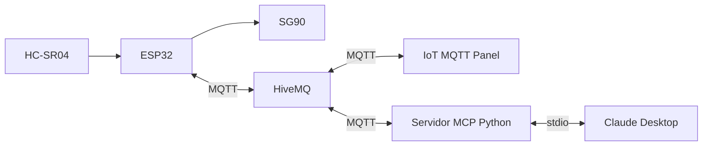

# Práctica MQTT con ESP32

El firmware implementa RF1, RF2 y RF3: mide distancia con un HC-SR04, la publica mediante MQTT y recibe posiciones para un servomotor SG90. Usa `broker.hivemq.com:1883` sin autenticación ni TLS. El broker es público: utiliza solo datos de prueba no sensibles.

## Configuración y conexiones

El proyecto integra un ESP32 con HC-SR04 y SG90, IoT MQTT Panel y un servidor MCP para Claude Desktop. El ESP32, la aplicación móvil y el servidor MCP se comunican a través de HiveMQ; Claude Desktop se comunica con el servidor MCP por stdio.

**Integrantes:** pendientes de registrar.

- Abre el proyecto en PlatformIO con el entorno `esp32doit-devkit-v1` y Arduino. PubSubClient ya está declarado en `platformio.ini`.
- Completa WiFi en `include/config.local.h`. Si no existe, copia `include/config.example.h` a ese nombre. El archivo local está excluido de Git. El broker, el puerto y el prefijo también se configuran allí.
- Los pines actuales son TRIG GPIO 18, ECHO GPIO 19 y servo GPIO 25; son configurables. Conecta ECHO mediante un divisor de tensión de 5 V a 3,3 V para proteger el ESP32. Alimenta el servo con una fuente adecuada y conecta su tierra a la del ESP32.
- El servo utiliza PWM LEDC de 50 Hz y un mapeo lineal de 0–180° a 500–2400 µs; 90° corresponde a 1450 µs. Los ángulos y pulsos se configuran mediante `SERVO_MIN_DEGREES`, `SERVO_MAX_DEGREES`, `SERVO_MIN_PULSE_US` y `SERVO_MAX_PULSE_US`.

## Tópicos y funcionamiento

Con el prefijo `sis234/grupo3`:

| Tópico | Mensaje | Dirección |
| --- | --- | --- |
| `sis234/grupo3/distancia/cm` | Decimal en centímetros, por ejemplo `25.4` | ESP32 publica |
| `sis234/grupo3/servo/cmd` | Entero en grados, por ejemplo `90` | ESP32 recibe |

Cada 500 ms se intenta una medición; se rechazan lecturas sin eco o fuera de 10–100 cm. Las lecturas válidas se publican mientras haya conexión MQTT, con una cifra decimal, QoS 0 y sin retención. No se acumulan lecturas para reenviarlas después de una desconexión.

El comando debe contener entre uno y tres dígitos ASCII, sin espacios, signos ni decimales, y encontrarse dentro de los límites configurados y de 0–180°. Se rechazan comandos retenidos y configuraciones de pulsos o límites inseguros. El servo no se mueve automáticamente al encender. Como se desconoce su posición inicial, el primer comando aplica directamente la posición solicitada; a partir de entonces avanza hacia cada objetivo en pasos de un grado, con un intervalo mínimo de 20 ms. El mensaje de posición solicitada no confirma el movimiento físico.

El firmware reintenta las conexiones WiFi y MQTT y vuelve a suscribirse tras una desconexión. El monitor serial muestra el estado de conexión, las publicaciones, lecturas inválidas y comandos recibidos. Publica comandos con retain desactivado y elimina cualquier comando retenido anteriormente en el broker.

## Prueba

En IoT MQTT Panel configura una conexión MQTT TCP a `broker.hivemq.com`, puerto `1883`, sin usuario ni contraseña, con un identificador de cliente distinto al del ESP32 y al del servidor MCP. Agrega un gauge suscrito a `sis234/grupo3/distancia/cm` y un slider de 0 a 180 que publique valores enteros en `sis234/grupo3/servo/cmd`, con QoS 0 y retain desactivado.

Para instalar el servidor Python y configurar Claude Desktop mediante stdio, sigue [mcp-server/README.md](mcp-server/README.md) y su ejemplo de configuración con rutas absolutas. El servidor ofrece `consultar_distancia()` y `mover_servo(angulo)`; publicar un comando no confirma el movimiento físico.

### Requisitos y estado de la demostración

| Requisito | Estado |
| --- | --- |
| RF1: medir distancia | Comprobado con el HC-SR04. |
| RF2: publicar distancia en MQTT | Comprobado. |
| RF3: recibir comandos para el actuador | Movimiento del SG90 comprobado mediante MQTT.fx. |
| RF4: visualización gráfica en la app | Gauge de distancia comprobado en IoT MQTT Panel. |
| RF5: control desde la app | Slider y movimiento del SG90 comprobados. |
| RF6: consulta y control mediante IA y MCP | Pendiente de prueba integral: Claude inicia el servidor e invocó la consulta con el ESP32 desconectado; faltan una lectura real y el movimiento físico mediante Claude. |

Para la demostración se proponen estos valores, aún sin medir: operación continua durante al menos 10 minutos; error máximo de ±3 cm entre 10 y 100 cm; respuesta del actuador en hasta 1 segundo; dos lecturas válidas por segundo; y reconexión automática WiFi y MQTT. Comprueba respectivamente el funcionamiento sin reinicios durante 10 minutos, compara lecturas con una cinta métrica, mide el tiempo desde el comando hasta el inicio del movimiento, cuenta publicaciones válidas durante un intervalo y desconecta y restablece WiFi y MQTT. Registra los resultados reales y las condiciones de cada medición.

1. Verifica la configuración y las conexiones físicas.
2. En PlatformIO ejecuta **Build**, conecta la placa y ejecuta **Upload**. Abre Serial Monitor a **115200 baudios**.
3. Con otro cliente MQTT conectado a `broker.hivemq.com:1883`, suscríbete a `sis234/grupo3/distancia/cm` y acerca un objeto al sensor dentro del rango de trabajo. Comprueba los valores y el monitor serial.
4. Envía un entero permitido, por ejemplo `90`, a `sis234/grupo3/servo/cmd` con QoS 0 y retain desactivado. Comprueba la recepción y el movimiento.
5. Interrumpe y restablece la conexión para comprobar la reconexión y la reanudación de las publicaciones.

